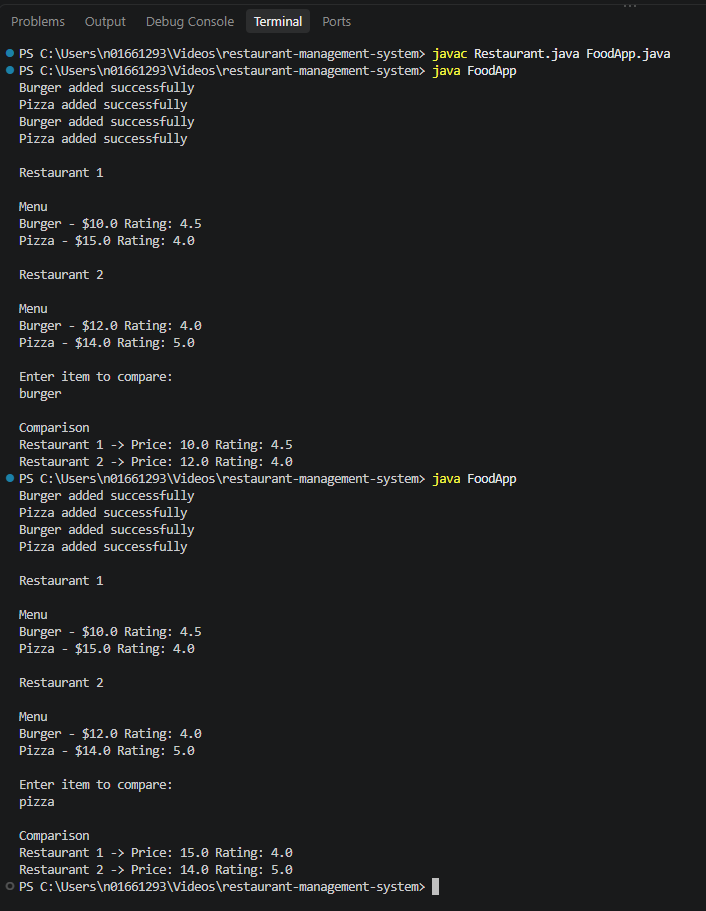

# Restaurant Management System

## Project Overview

The Restaurant Management System is a Java-based application developed using Object-Oriented Programming (OOP) principles. It allows restaurants to manage menu items, prices, and customer ratings while enabling users to compare food items across multiple restaurants based on pricing and average customer ratings.

## Features

- Add food items with prices
- Remove food items from the menu
- Add customer ratings to menu items
- Calculate average ratings
- Display menu items with prices and ratings
- Compare food prices and ratings between two restaurants
- Perform case-insensitive food item searches

## Technologies Used

- Java
- Object-Oriented Programming (OOP)
- ArrayList
- Scanner

## Project Structure

```text
restaurant-management-system-java
│
├── Restaurant.java
├── FoodApp.java
├── output.png
└── README.md
```

## Classes

### Restaurant.java

Responsible for:
- Managing menu items
- Storing item prices
- Recording customer ratings
- Calculating average ratings
- Displaying restaurant menus

### FoodApp.java

Responsible for:
- Creating restaurant objects
- Adding menu items and ratings
- Accepting user input
- Comparing food items between restaurants

## Requirements

- Java JDK 8 or later
- Visual Studio Code, IntelliJ IDEA, Eclipse, or any Java IDE

## How to Run

Compile the program:

```bash
javac Restaurant.java FoodApp.java
```

Run the application:

```bash
java FoodApp
```

## Program Output

### Restaurant Menu Comparison



The application displays menu items, prices, and average customer ratings for two restaurants and allows users to compare the same food item across both restaurants.

## Sample Output

```text
Burger added successfully
Pizza added successfully
Burger added successfully
Pizza added successfully

Restaurant 1

Menu
Burger - $10.0 Rating: 4.5
Pizza - $15.0 Rating: 4.0

Restaurant 2

Menu
Burger - $12.0 Rating: 4.0
Pizza - $14.0 Rating: 5.0

Enter item to compare:
burger

Comparison
Restaurant 1 -> Price: 10.0 Rating: 4.5
Restaurant 2 -> Price: 12.0 Rating: 4.0
```

## Example Comparison

| Item | Restaurant 1 Price | Restaurant 1 Rating | Restaurant 2 Price | Restaurant 2 Rating |
|--------|--------|--------|--------|--------|
| Burger | $10.0 | 4.5 | $12.0 | 4.0 |
| Pizza | $15.0 | 4.0 | $14.0 | 5.0 |

## Key Learning Outcomes

- Applied Object-Oriented Programming concepts in Java
- Implemented encapsulation through classes and methods
- Utilized dynamic data structures using ArrayList
- Developed user-interactive functionality with Scanner
- Implemented search, comparison, and rating calculation features

## Future Enhancements

- Database integration using MySQL
- Graphical User Interface (GUI)
- Online ordering functionality
- Customer management system
- Inventory management module

## Author

**Anvesh Rachakonda**

---
⭐ If you found this project useful, feel free to star the repository.